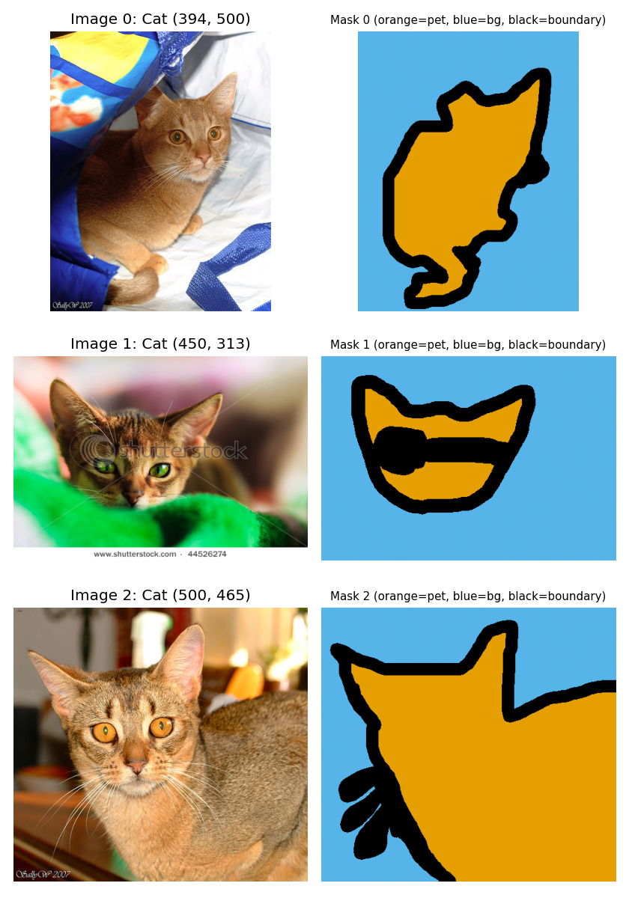
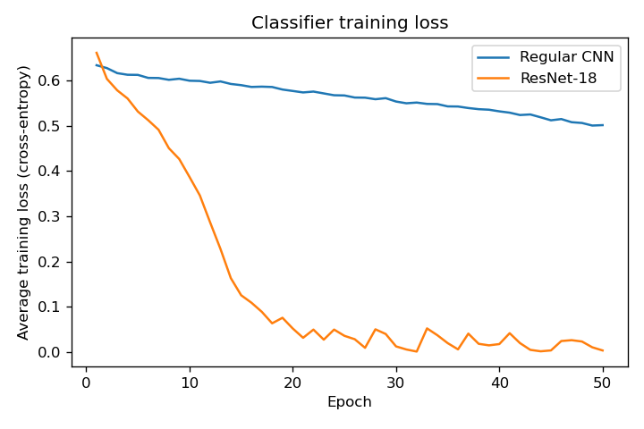
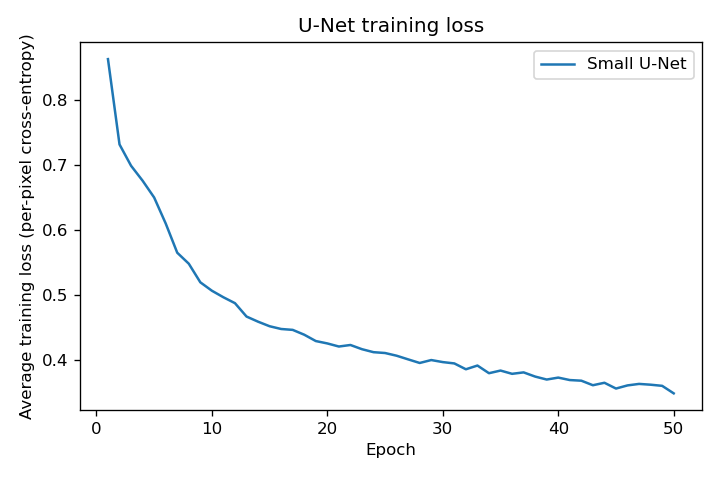
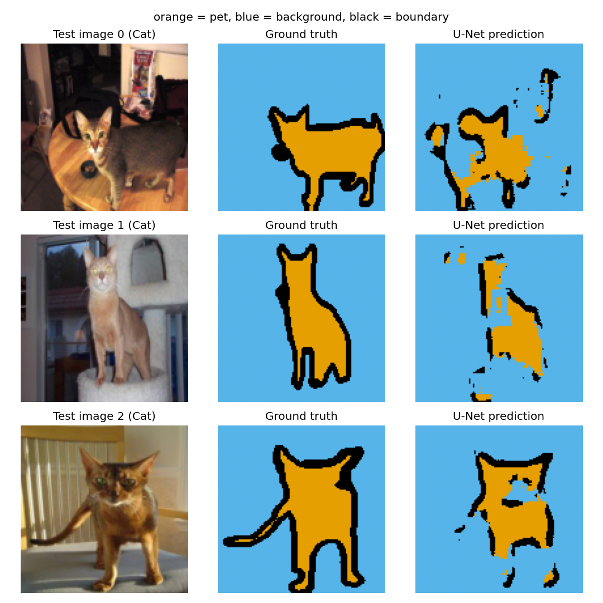

# Assignment 5: Regular CNN, ResNet-18, and Small U-Net on Oxford-IIIT Pet

Two tasks on the same Oxford-IIIT Pet images:

- **Classification** (cat vs. dog) with a regular CNN and ResNet-18.
- **Segmentation** (pet / background / boundary for every pixel) with a small U-Net.

All models were trained from scratch (random initialization, no pretrained weights).

---

## Section 1: Setup, running, and training settings

### Files

| File | Purpose |
|---|---|
| `data.py` | Provided data download and preprocessing code (unmodified) |
| `assignment5.py` | All code: exploration, models, training, evaluation, figures |
| `requirements.txt` | Exact package versions used (written by `assignment5.py --stage requirements`) |
| `figures/` | Output figures embedded below |
| `results/` | Dataset info, per-epoch training losses, and test metrics |
| `.gitignore` | Excludes `data/`, checkpoints, and cache files |

### Commands

Run everything from inside this folder, so that `data/`, `figures/`, and `results/` are created here.

Tested with Python 3.12 and the versions in `requirements.txt`: torch 2.5.1, torchvision 0.20.1, numpy 2.4.1, matplotlib 3.10.8, scikit-learn 1.8.0, tqdm 4.70.0, pillow 11.1.0.

```bash
# 1. Create a fresh environment and install dependencies with pip only
#    (mixing conda- and pip-installed numerical packages can cause library conflicts)
conda create -n env_csci4425 python=3.12.2 -y
conda activate env_csci4425
pip install -r requirements.txt

# 2. Download and check the data (~800 MB download, 1.6 GB on disk) into data/oxford-iiit-pet/
python data.py

# 3. Run the complete assignment: exploration, training of all three models, evaluation, and figures
python assignment5.py
```

Each stage can also be run separately:

```bash
python assignment5.py --stage explore                 # Part 1
python assignment5.py --stage train --model cnn       # Part 2, one model (cnn, resnet, unet, or all)
python assignment5.py --stage train --model unet --resume   # continue an interrupted run from its checkpoint
python assignment5.py --stage evaluate                # Parts 3-4: metrics and figures from saved checkpoints
```

Checkpoints are saved to `checkpoints/<model>.pt` after every epoch. They are not committed to GitHub, so the train stage must be run before the evaluate stage.

### Hardware

All three models were trained and evaluated on the **CPU** (`torch.cuda.is_available()` returned `False`).

| Model | Total training time (50 epochs) | Median time per epoch |
|---|---|---|
| Regular CNN | 1.0 h | 79 s |
| ResNet-18 | 3.4 h | 303 s |
| Small U-Net | 1.6 h | 71 s |

Epoch times varied considerably within each run, probably I was using the computer for other tasks while the program ran.

### Model architectures

**Model 1: Regular CNN (`SimpleCNN`), 23,714 trainable parameters**

| Layer | Output shape |
|---|---|
| Conv2d(3→16, 3×3, padding 1) + ReLU + MaxPool2d(2) | [B, 16, 64, 64] |
| Conv2d(16→32, 3×3, padding 1) + ReLU + MaxPool2d(2) | [B, 32, 32, 32] |
| Conv2d(32→64, 3×3, padding 1) + ReLU | [B, 64, 32, 32] |
| AdaptiveAvgPool2d((1,1)) + flatten | [B, 64] |
| Linear(64→2) | [B, 2] |

**Model 2: ResNet-18, 11,177,538 trainable parameters**

- `torchvision.models.resnet18(weights=None)` (random initialization).
- `model.fc` replaced with `nn.Linear(model.fc.in_features, 2)` (512 → 2) before the optimizer was created.
- All parameters trainable. Output: [B, 2].

**Model 3: Small U-Net (`SmallUNet`), 117,075 trainable parameters**

`DoubleConv(in, out)` = (3×3 conv, padding 1 → ReLU) × 2.

| Stage | Operation | Output shape |
|---|---|---|
| Encoder 1 | DoubleConv(3,16) → saved as E1 | [B, 16, 128, 128] |
| Down | MaxPool2d(2) | [B, 16, 64, 64] |
| Encoder 2 | DoubleConv(16,32) → saved as E2 | [B, 32, 64, 64] |
| Down | MaxPool2d(2) | [B, 32, 32, 32] |
| Bottleneck | DoubleConv(32,64) | [B, 64, 32, 32] |
| Up 1 | ConvTranspose2d(64,32, k=2, s=2) | [B, 32, 64, 64] |
| Skip 1 | concat with E2 (dim=1) | [B, 64, 64, 64] |
| Decoder 1 | DoubleConv(64,32) | [B, 32, 64, 64] |
| Up 2 | ConvTranspose2d(32,16, k=2, s=2) | [B, 16, 128, 128] |
| Skip 2 | concat with E1 (dim=1) | [B, 32, 128, 128] |
| Decoder 2 | DoubleConv(32,16) | [B, 16, 128, 128] |
| Output | Conv2d(16,3, k=1) | [B, 3, 128, 128] |

Before training, one batch was passed through each model to confirm the output shapes: [B, 2] for both classifiers and [B, 3, 128, 128] for the U-Net.

### Training settings

| Setting | Value (all three models) |
|---|---|
| Optimizer | Adam (a separate optimizer for each model) |
| Learning rate | 0.001 |
| Batch size | 16 |
| Epochs | 50 |
| Loss | `nn.CrossEntropyLoss` on raw outputs (no softmax) |
| Targets | `labels` for CNN and ResNet-18; `masks` for U-Net |
| Random seed | 0 (Python, NumPy, and PyTorch reseeded before each model) |
| Initialization | Random; no pretrained weights |
| Device | CPU |

**Training budget.** Both classifiers used the same settings: 50 epochs, batch size 16, Adam with learning rate 0.001, and the same seed. The budget is equal in epochs and weight updates, but not in compute: ResNet-18 has about 470× more parameters and took about 3.4× longer to train. 50 epochs was chosen instead of the suggested 100 because CPU training of ResNet-18 took about 5 minutes per epoch.

No hyperparameters were tuned. No settings were chosen using test results.

---

## Section 2: Results and analysis

### Dataset information (Part 1)

Output of the exploration stage (`results/data_info.txt`):

| Item | Value |
|---|---|
| Training samples | 3,680 |
| Testing samples | 3,669 |
| First training image size (width, height) | (394, 500) |
| First training image label | 0 (Cat) |
| First mask size (width, height) | (394, 500) |
| First mask unique values | [1, 2, 3] (1 = pet, 2 = background, 3 = boundary) |

Raw images and masks have different sizes. `data.py` resizes both to 128×128 for training. Masks are resized with nearest-neighbour interpolation, so the class values stay whole numbers, and they are shifted from 1–3 to 0–2.

First three training images and their masks (raw masks; orange = pet, blue = background, black = boundary):



### Processed batch shapes

One batch from `train_loader` (`get_loaders(batch_size=16)`; training loader shuffled, test loader in fixed order):

| Tensor | Shape | Notes |
|---|---|---|
| `images` | (16, 3, 128, 128) | float32, values in [0, 1] |
| `labels` | (16,) | int64; 0 = Cat, 1 = Dog |
| `masks` | (16, 128, 128) | int64; values 0 = pet, 1 = background, 2 = boundary |

### Classification accuracy (Part 3)

| Model | Test accuracy |
|---|---|
| Regular CNN | 0.7383 |
| ResNet-18 | 0.7986 |
| Majority-class baseline (always Dog) | 0.6776 |

### U-Net pixel accuracy

**U-Net pixel accuracy: 0.8292** (fraction of all 3,669 × 128 × 128 test pixels classified correctly)

Pixel accuracy is not comparable with the classification accuracies above, because it measures a different task.

### Training-loss plots





### Segmentation examples

First three test images: original image, ground-truth mask, and U-Net prediction (same color map, `vmin=0, vmax=2`).



---

### Analysis (Part 4)

#### 1. Classification performance

- **ResNet-18 performed better**: 79.86% vs. 73.83% test accuracy, a difference of 6.0 percentage points.
- **Both models beat the always-Dog baseline (67.76%)**: the CNN by 6.1 points and ResNet-18 by 12.1 points. The CNN's margin over the baseline is modest. 73.8% means it learned some cat/dog features, but not many.
- **The more complex model did perform better here**, but the gain came at a large cost. ResNet-18 has about 470× more parameters and took about 3.4× more training time, for 6 points of accuracy.

#### 2. Training losses

- **Regular CNN:** the loss decreased slowly and steadily, from 0.633 to 0.501, and was still decreasing at epoch 50. It never levelled off, so the CNN is probably under-trained: more epochs would likely lower the loss further. Whether that would also improve test accuracy is untested.
- **ResNet-18:** the loss fell quickly, from 0.661 to below 0.10 by epoch 17, then **levelled off near zero with frequent spikes** (for example 0.0015 at epoch 32, then 0.053 at epoch 33). A training loss near zero means the model fits the training images almost perfectly. Yet its test accuracy is only 79.9%, so ResNet-18 is overfitting: it memorized much of the 3,680 training images rather than learning features that generalize. The spikes are typical of Adam at a fixed learning rate once the loss is that small.
- **U-Net:** the loss dropped quickly, from 0.863 to about 0.51 in the first 10 epochs, then decreased slowly with small fluctuations to 0.349 at epoch 50. It is levelling off but still slowly decreasing.
- Classification and segmentation losses measure different tasks, so their values are not compared with each other.
- **Limitation:** only training loss was recorded. With no validation loss, overfitting can only be inferred from the gap between near-zero training loss and test accuracy.

#### 3. Segmentation results

- **Overall shape:** the U-Net captures the rough location and outline of the pet in all three examples, but none of the shapes is complete.
  - *Test image 2* is the best result: the body, head, and ears are recognizable.
  - *Test image 0* (a cat on a cluttered table) is fragmented: the pet region is patchy, and boundary-class pixels appear in the background, at the top right.
  - *Test image 1* (a light-colored cat in front of a bright window) is the weakest: much of the head and upper body is predicted as background.
- **Where predictions differ from the ground truth:**
  - Thin structures are missed, such as the tail in image 2 and the legs in images 0 and 2.
  - The pet's interior has holes, for example near the face in image 2.
  - Isolated false-positive pet and boundary specks appear in the background.
  - Errors are worst where the pet's color is similar to the background (image 1) or the background is busy (image 0).
- **Pixel accuracy is optimistic.** Background makes up a large share of each image and is mostly predicted correctly, so 82.9% pixel accuracy overstates how well the pets themselves are segmented. The figures show substantial errors on the pet pixels. 
- **What segmentation reveals that classification does not:** a classifier gives one label per image and does not show where the pet is or which pixels drove the decision. Segmentation shows the pet's location and outline. It also exposes specific failure modes, such as missed tails and legs and confusion with similar-colored backgrounds, that one accuracy number per image doesnt convey.

---

### GenAI acknowledgment

Claude (Anthropic, Claude Opus 5.5) was used to:

- **Code:** scaffold the model, training, evaluation, and plotting python code in `assignment5.py`. All code was reviewed, run, and edited by me. The same acknowledgment appears at the top of `assignment5.py`.
- **Environment:** troubleshoot environment setup (a duplicate OpenMP runtime error in Conda).
- **README:** draft this README from my own results files (`results/*.json`, `results/data_info.txt`, `results/metrics.md`) and figures. All numbers come from my actual runs, and I reviewed and edited the analysis.
