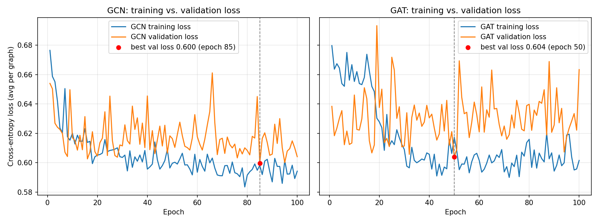

# Homework 6 – Graph Classification on PROTEINS with GCN and GAT

## 1. Installation and How to Run

### 1.1 Create the environment and install packages

Run these in **Anaconda Prompt** (Windows) or a terminal (macOS/Linux):

```bash
conda create -n env_csci4425 python=3.12
conda activate env_csci4425

conda install numpy
conda install matplotlib
conda install scikit-learn
conda install pytorch torchvision torchaudio -c pytorch
pip install torch-geometric
```

Check that everything is installed in this environment:

```bash
python -c "import sys, torch, torch_geometric, sklearn, matplotlib; print(sys.executable); print(torch.__version__, torch_geometric.__version__)"
```

The printed path should end in `envs/env_csci4425/python` (Windows: `envs\env_csci4425\python.exe`).

### 1.2 Select the environment

The code must run with the `env_csci4425` Python. Another Python install (for example a separate Python 3.14) will fail with
`ModuleNotFoundError: No module named 'matplotlib'` or `'torch_geometric'`.

**In VS Code (or another IDE):**

1. Open the folder that contains `homework6`.
2. Press `Ctrl+Shift+P` (macOS: `Cmd+Shift+P`) → **Python: Select Interpreter** → choose **`env_csci4425`**.
   If it is not listed, choose **Enter interpreter path** and enter
   `C:\Users\<you>\anaconda3\envs\env_csci4425\python.exe` (Windows) or `~/anaconda3/envs/env_csci4425/bin/python` (macOS/Linux).
3. Check the status bar in the bottom-right corner. It should show `env_csci4425`, not another Python version.
4. Open a **new** terminal (**Terminal → New Terminal**). If it shows `(base)`
   or nothing, run `conda activate env_csci4425`.

**In a terminal:**

```bash
conda activate env_csci4425
```

If a package is missing, install it with `python -m pip install <package>` so it goes into the active environment.

### 1.3 Run the code

```bash
cd homework6
python hw6.py
```

`hw6.py` downloads PROTEINS into `data/TUDataset/` on the first run (ignored by git), prints all results
to the console, and saves the loss-curve figure as `loss_curves.png` (included in this folder so the figure below renders).
Training runs on CPU and takes about 3 minutes.

## 2. Results

### Part 1 – Data Loading and Exploration

Dataset loaded with `TUDataset(root="data/TUDataset", name="PROTEINS")`.

| Property | Value |
|---|---|
| Number of graphs | 1113 |
| Number of classes | 2 |
| Number of node features | 3 |
| Average number of nodes per graph | **39.06** |
| Average number of edges per graph | 145.63 (directed `edge_index` columns; ≈72.8 undirected) |
| Class counts | class 0: 663, class 1: 450 |

First graph, `dataset[0]`:

| Item | Value |
|---|---|
| Data object | `Data(edge_index=[2, 162], x=[42, 3], y=[1])` |
| `x.shape` | `(42, 3)` → 42 nodes, 3 features per node |
| `edge_index.shape` | `(2, 162)` → 162 directed edges |
| `y` | `tensor([0])` |

Full console output for Part 1:

```text
Dataset: PROTEINS(1113)
Number of graphs:        1113
Number of classes:       2
Number of node features: 3

First graph (dataset[0]):
Data(edge_index=[2, 162], x=[42, 3], y=[1])

Node feature matrix x:
tensor([[1., 0., 0.],
        [1., 0., 0.],
        [1., 0., 0.],
        [1., 0., 0.],
        [1., 0., 0.],
        [1., 0., 0.],
        [1., 0., 0.],
        [1., 0., 0.],
        [1., 0., 0.],
        [1., 0., 0.],
        [1., 0., 0.],
        [1., 0., 0.],
        [1., 0., 0.],
        [1., 0., 0.],
        [1., 0., 0.],
        [1., 0., 0.],
        [1., 0., 0.],
        [1., 0., 0.],
        [1., 0., 0.],
        [1., 0., 0.],
        [1., 0., 0.],
        [1., 0., 0.],
        [0., 1., 0.],
        [0., 1., 0.],
        [0., 1., 0.],
        [0., 1., 0.],
        [0., 1., 0.],
        [0., 1., 0.],
        [0., 1., 0.],
        [0., 1., 0.],
        [0., 1., 0.],
        [0., 1., 0.],
        [0., 1., 0.],
        [0., 1., 0.],
        [0., 1., 0.],
        [0., 1., 0.],
        [0., 1., 0.],
        [0., 1., 0.],
        [0., 1., 0.],
        [0., 1., 0.],
        [0., 1., 0.],
        [0., 1., 0.]])
x.shape: (42, 3)

Edge index edge_index:
tensor([[ 0,  0,  0,  1,  1,  1,  2,  2,  2,  3,  3,  3,  3,  3,  4,  4,  4,  4,
          4,  4,  5,  5,  5,  6,  6,  6,  7,  7,  7,  7,  8,  8,  8,  8,  8,  9,
          9,  9,  9,  9,  9, 10, 10, 10, 11, 11, 11, 12, 12, 12, 13, 13, 13, 13,
         14, 14, 14, 14, 15, 15, 15, 16, 16, 16, 16, 17, 17, 17, 18, 18, 18, 18,
         19, 19, 19, 19, 19, 19, 19, 19, 20, 20, 20, 21, 21, 21, 22, 22, 22, 22,
         23, 23, 23, 23, 23, 24, 24, 24, 25, 25, 25, 26, 26, 26, 27, 27, 27, 28,
         28, 28, 29, 29, 29, 30, 30, 30, 31, 31, 31, 31, 31, 31, 32, 32, 32, 32,
         33, 33, 33, 33, 33, 34, 34, 34, 34, 35, 35, 35, 35, 36, 36, 36, 37, 37,
         37, 38, 38, 38, 38, 39, 39, 39, 39, 40, 40, 40, 41, 41, 41, 41, 41, 41],
        [11, 22, 32, 23, 31, 41, 24, 29, 34,  4, 28, 29, 38, 39,  3, 14, 28, 29,
         38, 39,  6,  7, 26,  5,  7,  8,  5,  6, 19, 25,  6,  9, 10, 25, 35,  8,
         10, 19, 21, 25, 35,  8,  9, 20,  0, 22, 32, 31, 33, 41, 14, 15, 34, 39,
          4, 13, 15, 39, 13, 14, 38, 17, 18, 19, 36, 16, 18, 19, 16, 17, 19, 35,
          7,  9, 16, 17, 18, 20, 21, 35, 10, 19, 21,  9, 19, 20,  0, 11, 30, 40,
          1, 24, 31, 34, 41,  2, 23, 33,  7,  8,  9,  5, 27, 37, 26, 28, 36,  3,
          4, 27,  2,  3,  4, 22, 31, 32,  1, 12, 23, 30, 33, 41,  0, 11, 30, 40,
         12, 24, 31, 34, 41,  2, 13, 23, 33,  8,  9, 18, 19, 16, 27, 37, 26, 36,
         38,  3,  4, 15, 37,  3,  4, 13, 14, 22, 32, 41,  1, 12, 23, 31, 33, 40]])
edge_index.shape: (2, 162)

Graph label y: tensor([0])

Average number of nodes per graph: 39.06
Average number of edges per graph: 145.63 (directed; each undirected edge counted twice)
Class counts: {np.int64(0): np.int64(663), np.int64(1): np.int64(450)}
```

### Part 2 – Train / Validation / Test Split

Graph-level split with `sklearn.model_selection.train_test_split`, **`random_state=0`**, stratified by class label
so the class balance is the same in every subset. First 20% of graphs were held out for testing,
then 12.5% of the remaining 80% was assigned to validation (= 10% of the full dataset). The script asserts that no graph
appears in more than one set, and the same split is used for both GCN and GAT.

| Set | Graphs | Fraction |
|---|---|---|
| Training | 778 | 69.9% |
| Validation | 112 | 10.1% |
| Test | 223 | 20.0% |
| **Total** | 1113 | 100% |

Use of each set: training → parameter updates; validation → checkpoint selection (lowest validation loss);
test → final evaluation only.

### Part 3 – Models and Training

Mini-batches are built with `torch_geometric.loader.DataLoader` (`batch_size=32`; training loader shuffled, validation/test not).
Each batch contains `x` `[num_nodes, 3]`, `edge_index` `[2, num_edges]`, `batch` `[num_nodes]` (graph id of each node,
used by `global_mean_pool`) and `y` `[num_graphs]`.

| Setting | GCN | GAT |
|---|---|---|
| Layers | `GCNConv(3, 64)` → ReLU → dropout → `GCNConv(64, 64)` → ReLU | `GATConv(3, 64, heads=4)` → ELU → dropout → `GATConv(256, 64, heads=1, concat=False)` → ELU |
| Readout | `global_mean_pool` → `Linear(64, 2)` | `global_mean_pool` → `Linear(64, 2)` |
| `in_channels` / `num_classes` | `dataset.num_features` = 3 / `dataset.num_classes` = 2 | same |
| Hidden channels | 64 | 64 (4 heads in layer 1) |
| Dropout | 0.5 | 0.5 |
| Loss / optimizer | `nn.CrossEntropyLoss` / `Adam(lr=0.01)` | same |
| Epochs | 100 | 100 |
| Checkpoint rule | lowest average validation loss | same |

Training and validation losses (average per graph) printed every 10 epochs:

| Epoch | GCN train | GCN val | GAT train | GAT val |
|---|---|---|---|---|
| 1 | 0.6765 | 0.6540 | 0.6798 | 0.6384 |
| 10 | 0.6201 | 0.6171 | 0.6553 | 0.6461 |
| 20 | 0.6052 | 0.6046 | 0.6278 | 0.6376 |
| 30 | 0.6036 | 0.6114 | 0.6090 | 0.6114 |
| 40 | 0.5956 | 0.6455 | 0.6057 | 0.6305 |
| 50 | 0.5996 | 0.6164 | 0.6173 | 0.6040 |
| 60 | 0.5935 | 0.6177 | 0.6016 | 0.6210 |
| 70 | 0.5911 | 0.6166 | 0.5937 | 0.6250 |
| 80 | 0.5915 | 0.6083 | 0.6159 | 0.6398 |
| 90 | 0.5869 | 0.6058 | 0.5943 | 0.6256 |
| 100 | 0.5942 | 0.6041 | 0.6015 | 0.6634 |

### Part 4 & 5 – Checkpoint Selection and Test-Set Performance

Selected checkpoints (chosen by validation loss only; the test set was not used for selection or tuning):

| Model | Best epoch | Lowest validation loss |
|---|---|---|
| GCN | 85 | **0.5997** |
| GAT | 50 | 0.6040 |

Final metrics on the held-out test set (223 graphs). Predictions are `argmax(dim=1)` of the output scores;
precision, recall and F1 are computed for class 1 (scikit-learn's default positive label).

| Model | Accuracy | Precision | Recall | F1-score |
|---|---|---|---|---|
| GCN | **0.7220** | **0.7000** | **0.5444** | **0.6125** |
| GAT | 0.7085 | 0.6923 | 0.5000 | 0.5806 |

**Comparison.** GCN did slightly better than GAT on every test metric. The largest gap is in recall
(0.544 vs. 0.500), so GAT misses more class‑1 graphs. The gap is small: 1.35 percentage points of accuracy is only 3 of 223 test graphs, which is within what a different random seed or split could produce. This run does not show that one architecture is better. Both models predict class 0 (the majority class, 59.6%) more reliably than class 1, as the recall values of about 0.5 show. GCN also reached the lower validation loss (0.5997 vs. 0.6040), but the validation set has only 112 graphs, so that difference is small too.

### Training and Validation Loss Curves



*Blue = training loss, orange = validation loss; red dot and dashed line = selected (lowest validation loss) checkpoint.*

- **How the losses change.** Both models drop quickly in the first ~10–20 epochs (from ≈0.68, close to the
  loss of always guessing, to ≈0.60–0.62) and then level off. After that, training loss decreases only slowly
  (GCN ≈0.59, GAT ≈0.59–0.62), and validation loss moves around a flat level instead of going down further.
- **Overfitting.** There is no strong overfitting: training loss never drops far below validation loss. For GCN the gap
  stays small (≈0.01–0.03), and its validation loss is still near its minimum late in training (best epoch 85).
  GAT shows mild overfitting after its best epoch (50): its validation loss drifts upward and gets noisier
  (≈0.62–0.67, ending at 0.663) while training loss stays near 0.59–0.61, so the gap gets bigger. The models are limited mainly by the very simple input (3 one-hot features per node) rather than by memorizing the training set.
- **Stability.** GCN trains more steadily and reaches the lower validation loss (0.5997 vs. 0.6040). Its training curve decreases smoothly, and its validation loss stays mostly in 0.60–0.63, apart from a few spikes. GAT's training loss stays higher and is noisier for the first ~25 epochs, and its validation loss swings much more widely (up to ≈0.69 near epoch 19). This fits GAT having more parameters (4 attention heads) and being trained with a relatively high learning rate (0.01).

*Note: the values above come from running `hw6.py` with seed 0 in `env_csci4425` (Python 3.12, Windows, CPU).
Exact numbers may differ slightly between PyTorch/PyG versions or operating systems.*

*Ai use: Claude (Anthropic) was used to help draft code, check grammar, and troubleshoot. All material was reviewed and verified by Josh Propfe.*
